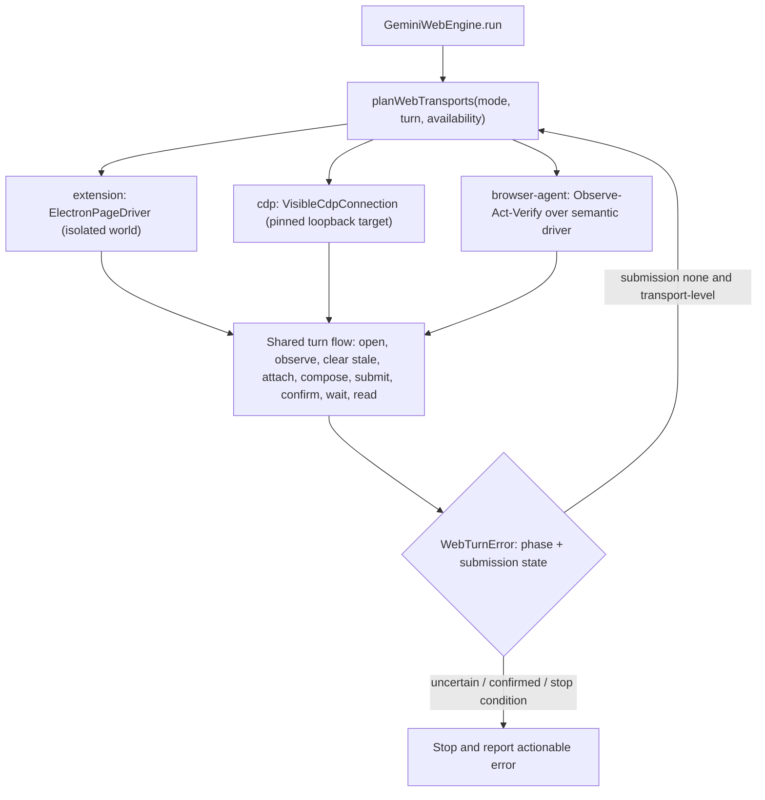

# Gemini Web — Browser Modes Plan (supersedes the previous Gemini Web fix plan)

Status: **complete** · Owner: ND engines/browser · Last reconciled: 2026-10-20

This plan replaces the previous Gemini Web task. Completed work from that task is
kept and mapped into the phases below; nothing is reset or redone.

## 0. Reconciliation of uncommitted work

`git status` shows one working tree that mixes several earlier tasks. Only the
Gemini/web-engine slice belongs to this plan; the rest is preserved untouched.

| Area | Files | State | Owner |
| --- | --- | --- | --- |
| Gemini image attachments via Gemini's uploader (`DOM.setFileInputFiles`), stale chip removal, pending-send stall detection, image previews on user turns | `gemini-web-engine.ts`, `web-attachments.ts`, `chat-types.ts`, `contracts.ts`, `engine-session-router.ts`, `tests/gemini-web-engine.test.ts`, `tests/web-attachments.test.ts` | **Done** (14 Gemini tests green) | this plan (P0) |
| ChatGPT Web image attachments (same pattern) | `chatgpt-web-engine.ts`, `tests/chatgpt-web-engine.test.ts` | Done | out of scope (kept) |
| Generic attachments for CLI engines, MarkdownLite, chat events | `attachment-delivery.ts`, `run-files.ts`, `shared/attachments.ts`, `MarkdownLite.tsx`, `chat-events.ts`, extra CLI engines | Done | out of scope (kept) |
| ND Computer Use extension + Rust `computer_use` | `extensions/nd-computer-use`, `crates/nd-runtime/src/computer_use`, `core-computer.ts`, `computer-use-service.ts` | Separate task | out of scope (kept) |

## 1. Existing infrastructure we reuse (do not rebuild)

- **`BrowserController`** — the canonical embedded `WebContentsView`; owns tabs,
  `navigate`, `executeJavaScript`, `capturePage`, and an injected semantic driver
  (`semanticSnapshot` / `click` / `fill` / `press` with `ref` + `revision`).
- **`BrowserTarget` / `BrowserTargetRouter`** (`src/main/browser-platform`) —
  already the unified, agent-facing browser tool layer for built-in and
  Companion targets, with capability flags, leases, approvals and receipts.
  P1 therefore *extends* this layer instead of inventing a new one.
- **Loopback CDP** (`--remote-debugging-address=127.0.0.1`) — used by the
  existing Gemini engine through its private `VisibleCdpConnection`.
- **Extension DOM infrastructure** — ND extensions (e.g. ND Translate's Gemini
  provider) integrate with provider pages through fixed, main-owned scripts run
  inside the ND browser tab (`BrowserController.readTranslatePage`), no CDP.
  The ND Browser Companion is a Chrome MV3 extension for the user's *external*
  Chrome profile.

> [!IMPORTANT]
> **Decision: Extension Mode = content-script-style isolated-world execution in
> ND's embedded tab** (the same mechanism ND extensions use for Gemini), not the
> external Chrome Companion. The Gemini engine is defined on ND's visible pane;
> driving a different browser profile would silently change Google account
> identity, which `BrowserTargetRouter` forbids for Auto. Companion support
> stays a future, explicit-only option.

## 2. Gaps found while double-checking the code (feed P0)

1. **Duplicate submission** — a turn that fails *after* the Send click (CDP
   timeout, socket close, deadline) is indistinguishable from a pre-send
   failure; resending duplicates the prompt in Gemini. No "uncertain" state.
2. **Stale attachments** — chips are only cleared when the *new* turn has
   images; a text-only turn after a failed image turn still ships the stale
   image. Label match is case-sensitive (`'close attachment'`).
3. **Binding correctness**
   - Auto-binding captures whatever conversation the pane shows — including a
     conversation owned by *another ND session*, which then becomes the project
     binding and redirects every later session into it.
   - Name fallback in `getGemBinding` uses the *currently open* project's name
     regardless of the requested root → cross-project leakage.
   - The binding URL overrides a session's own conversation, so an existing
     session can be redirected after the binding changes.
   - `captureConversationUrl` accepts any conversation the pane navigates to
     during a turn (user navigation can rebind the session).
4. **CDP access** — the connection follows the *active* tab, does not verify the
   target page origin before evaluating scripts or uploading files, and does not
   validate that `webSocketDebuggerUrl` is the expected loopback endpoint.
5. **Submission confirmation** — success is "the Send button was clicked"; no
   evidence that Gemini accepted the turn.
6. **Cancellation** — `stop()` clicks Gemini's Stop button even when ND aborted
   *before* submitting (could stop an unrelated reply); sleeps are not abortable.
7. **Stop conditions** — login/challenge are checked only while opening; no
   rate-limit/quota detection; page busy with a browser-originated reply is not
   checked before composing.

## 3. Architecture

- **`PageDriver`** (`src/main/browser/page-driver.ts`): `evaluate`,
  `setFilesOnInput`, `screenshot`, `close`, pinned to one ND tab. Engines see
  no CDP ids or WebContents.
  - `ElectronPageDriver` — `executeJavaScriptInIsolatedWorld` on the pinned tab;
    uploads via `DataTransfer`. No debugger socket.
  - `VisibleCdpConnection` (moved to `src/main/browser/visible-cdp-connection.ts`)
    — pinned target id, loopback-only WS URL validation, page-origin guard.
- **Browser Agent** (`src/main/browser/browser-agent.ts`): generic
  Observe → Act → Verify step runner over the existing semantic driver, with
  stale-ref re-observation, bounded attempts, optional screenshot evidence for
  visual recovery, and a planner hook for a future model-driven planner.
- **Modes** (`src/shared/browser-modes.ts`): `auto | extension | cdp |
  browser-agent`, default `auto`, plus `agentFallback` (opt-in).
- **Auto order**: Extension (when compatible) → CDP → Browser Agent (only when
  `agentFallback`) → actionable error. Switching only when the failed attempt
  provably did not submit (`submission: 'none'`) and the failure is a
  transport/layout failure. Never after uncertain submission, never for
  login / challenge / rate-limit / user stop.
- **Compatibility rule**: image turns prefer CDP in Auto until Extension
  `DataTransfer` uploads are live-validated against gemini.google.com.

## 4. Phases

### P0 — Reliability and safety fixes (continue existing work)
- [x] Image upload through Gemini's uploader, settle detection, temp-file cleanup
- [x] Pending-send stall → actionable sign-in error
- [x] Typed `WebTurnError` with `phase` and `submission` (`none|uncertain|confirmed`)
- [x] Duplicate prevention: remember uncertain prompts; on resend, adopt the
      already-submitted DOM turn instead of submitting again
- [x] Always clear stale attachment chips before composing (case-insensitive)
- [x] Binding fixes (no auto-bind of ND-owned conversations, root-scoped name
      fallback, session conversation precedence, guarded URL capture)
- [x] CDP: pinned tab target, loopback WS validation, Gemini-origin guard
      before scripts/uploads
- [x] Submission confirmation (new user turn / busy / pending-send / composer
      cleared) with explicit not-submitted vs uncertain outcomes
- [x] Cancellation: click page Stop only after submission; abortable waits
- [x] Stop conditions during the whole turn: login, challenge, rate limit,
      busy page before compose

### P1 — Unified page driver layer
- [x] `PageDriver` contract + `ElectronPageDriver` + moved `VisibleCdpConnection`
- [x] `BrowserController.evaluateInTab` (isolated world, pinned tab, main-only)
- [x] Semantic driver `fill` uses `insertText` for contenteditable editors

### P2 — Three execution adapters
- [x] Extension adapter (isolated world driver, scripted Gemini recipe)
- [x] CDP adapter (existing recipe, hardened)
- [x] Browser Agent adapter (Observe → Act → Verify composer/send steps)

### P3 — Auto mode
- [x] Pure `planWebTransports` + guarded fallback loop in the engine

### P4 — UI, tests, docs
- [x] Mode persisted in the Gemini Web store; IPC get/set; preload; preview stub
- [x] Selector `Auto | Extension | CDP | Browser Agent` in the Gemini banner
- [x] Tests: planner, fallback guards, duplicate adoption, binding, stop
      conditions, Browser Agent loop, driver origin guards
- [x] Docs: this plan + `docs/architecture.md` note

### P5 — ChatGPT Web parity (2026-10-20)
- [x] ChatGPT Web moved off its private CDP class onto the shared
      `PageDriver` / `VisibleCdpConnection` / `ElectronPageDriver` layer
- [x] `Auto | Extension | CDP | Browser Agent` modes, per-engine persisted
      settings, IPC get/set, preload, preview stub, and banner selector
- [x] Typed `WebTurnError` submission states, one-shot Browser Agent submit,
      DOM confirmation, uncertain-prompt adoption, and post-submit-only Stop
- [x] Page-busy pre-compose, auth/Cloudflare redirect classification,
      image-echo dedupe, stale attachment clearing, active-turn temp cleanup
- [x] Git sync removed (2026-10-21): ChatGPT Web is a conversation transport only
- [x] Tests: mode persistence, page busy, post-click uncertainty, guard
      redirects, stop gating, image echoes; live text/image/cancel verified

## 5. Explicit non-goals / limits
- No automation-detection evasion; no transport switching to bypass sign-in,
  CAPTCHA, rate limits or access restrictions.
- No hidden/second browser; all modes act on ND's visible pane.
- ChatGPT Web uses the same transport layer but keeps its Git-sync and guest
  conversation behavior.
- Browser Agent planning is deterministic (semantic heuristics); the planner
  hook is where a model-driven planner plugs in later. Screenshot capture is
  evidence for recovery, not autonomous vision.
